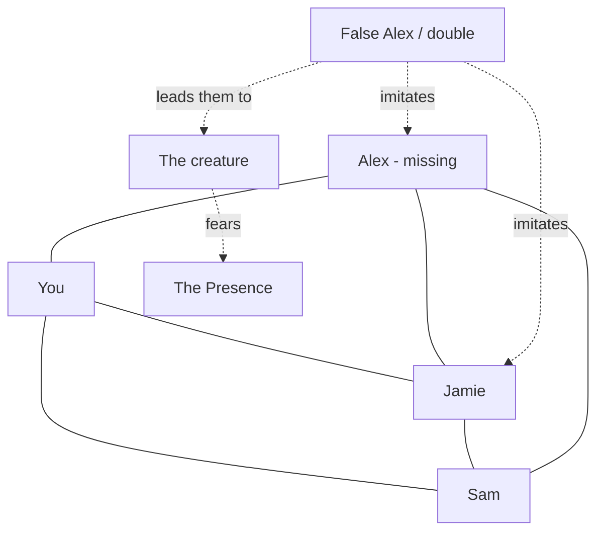

# Character relationships

*(If the diagram does not render, read the tables below; they say the same thing.)*

## The four friends

| Pair | Dynamic | Evidence |
|---|---|---|
| **Jamie ↔ Sam** | The engine of every scene: Jamie pushes, Sam objects, Sam comes anyway, they end up together. Teasing with affection. | "We should go get the cops." / "And tell them what?" (Ch2) · "Jamie. Don't." (Ch4) · the yellow gate (Ch5) · "You ran like a duck." "I did not run like a duck." (Ch5) |
| **You ↔ Jamie** | You wake him first; he hands you a flashlight; he runs ahead and calls you on. | Ch1 window, Ch1 spare flashlight, Ch4 escape |
| **You ↔ Sam** | Sam trusts you to decide; he hands you the camera and the batteries; you take his compromise. | Ch5 garage, Bluejay, the gate decision |
| **You ↔ Alex** | You don't remember what you said back. | Prologue narration |
| **Jamie ↔ Alex** | The phenomena call **Jamie's** name with Alex's voice ("Jamie?" Ch3, Ch4, Ch5); Jamie cannot let go ("I'm not leaving him."). | Ch3–5 |
| **Sam ↔ Alex** | Sam noticed what the others missed (Alex stopped) and keeps his shirt. | Ch1–2, Ch5 |
| **The three ↔ Alex** | JSA in chalk at the lookout, and JSA cut fresh in Owl. AR is not one of them. | Ch0, Ch5 |

## The friends and the adults

The boys sneak out (Ch1), are sent home (Ch2), lie about where they are (Ch5: "She thinks we're at Jamie's."), and
promise to tell "everything" tomorrow (Ch5). No adult has believed them about the bell.

## Group decisions so far

| Moment | Who wanted what | Resolution |
|---|---|---|
| The oak, Ch1 | Sam: Alex stopped; you: no | Jamie: "Then let's go the way he went." (Ch2 proves Sam right) |
| The fence, Ch2 | Sam: get the cops; Jamie: a little farther | Sam: "…Fine. Stay together." |
| The night plan, Ch3 | Jamie: come back tonight; Sam: no | "If anything happens, we leave. Right away." |
| The helmet, Ch3 | Sam: tell somebody now; Jamie: to the end | They go on |
| The gangway and marquee, Ch4 | Jamie toward Alex; Sam holds him | Nobody follows |
| The yellow gate, Ch5 🟡 | Jamie: go; Sam: nobody knows we're here | **The player decides** |
| The split, Ch5 🟡 | Jamie: Alex is in Owl; Sam: the office is the way out | Sam's compromise: "Together." |

## The supernatural

- The false Alex imitates Alex; the double imitates Jamie; voices imitate Alex and Sam's mother.
- The false Alex led them to the creature (Ch3); they are never seen together.
- The creature fears the Presence (Ch4, Ch5).
- What any of these are to each other: ❓ UNKNOWN.
